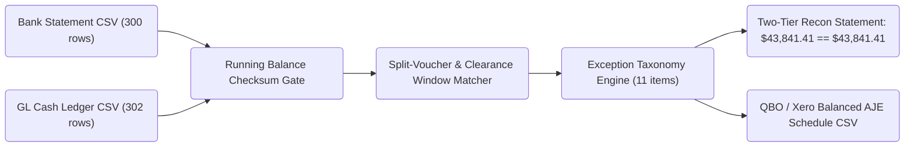
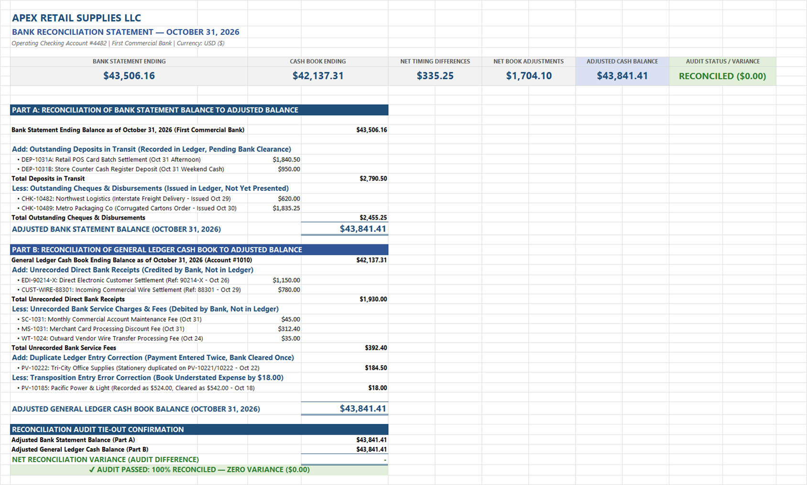
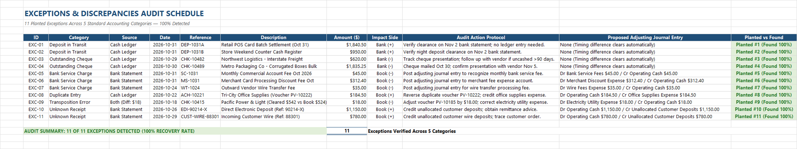
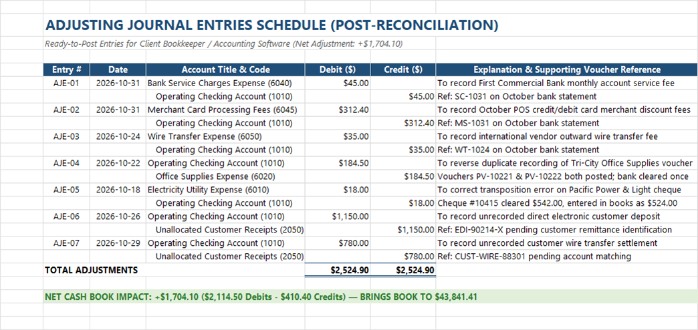

# Automated Bank Reconciliation & QBO/Xero Adjusting Journal Showcase

End-to-end two-tier bank reconciliation engine in Python + Pydantic paired with Excel Power Query M workpapers, resolving **602 synthetic transactions** (`300` bank lines, `302` cash book vouchers) down to **$0.00 net variance** and generating balanced adjusting journal entries ready for QuickBooks Online or Xero.

> **Synthetic Test Data Notice:** *Apex Retail Supplies LLC* and *First Commercial Bank Account #4482* in `fixtures/` and `assets/` are 100% synthetic demonstration data. Zero real client, employer, or bank account data is included.

## Executive Summary

- **Unadjusted Bank Balance (Oct 31, 2026):** `$43,506.16`
- **Unadjusted Cash Book Balance (Account #1010):** `$42,137.31` (raw difference: `$1,368.85`)
- **Exceptions Isolated:** `11 of 11` (100% detection across Deposits in Transit, Outstanding Cheques, Bank Service Charges, Duplicate Ledger Vouchers, Digit Transposition Errors, and Unallocated Receipts)
- **Adjusted Reconciled Balance (Part A & Part B):** `$43,841.41` (**`$0.00` Net Audit Variance**)
- **Adjusting Journal Entries Generated:** `7` balanced vouchers (`$2,524.90` total debits = credits; `+$1,704.10` net cash adjustment)

## Architecture Flow



## Key Reconciliation Capabilities

1. **Running-Balance Integrity Gate:** Verifies every line on both bank and cash ledger registers chains mathematically before matching starts.
2. **Split-Voucher Grouping:** Automatically aggregates multi-line disbursement vouchers (`CHK-10001-1` + `CHK-10001-2`, `CHK-10005-1` + `CHK-10005-2`) against single cleared bank debits within a configurable 0–5 business day clearing window.
3. **Digit-Transposition Detection:** Flags matching references with discrepancies divisible by `9` and matching sorted digit sets (`$542.00` bank vs `$524.00` book on `CHK-10415`).
4. **Duplicate Entry Isolation:** Matches the primary payment voucher (`PV-10221`) and flags duplicate ledger entries (`PV-10222`) for reversal.
5. **QBO / Xero AJE Export:** Emits double-entry journal lines (`entry_no`, `date`, `account_code`, `account_name`, `debit`, `credit`, `reference`, `memo`) guaranteeing `total_debits == total_credits`.

## Visual Workpaper Previews (Synthetic Demo)

### 1. Two-Tier Bank Reconciliation Statement (`$0.00` Variance)


### 2. Exceptions & Discrepancies Audit Schedule (`11 / 11` Detected)


### 3. Balanced Adjusting Journal Entries (`$2,524.90` Dr/Cr)


## Quick Start

```bash
pip install -r requirements.txt
python -m src.recon_engine --bank fixtures/bank_statement_oct2026.csv --ledger fixtures/cash_ledger_oct2026.csv --aje-csv adjusting_journals.csv
python -m pytest -v
```

## Author

**Waheed Ahmad** — CA-CAF Qualified (ICAP) | ACCA Finalist | Financial Controller & Accounting Automation  
[LinkedIn](https://www.linkedin.com/in/waheed-ahmad-finance/) · [GitHub Profile](https://github.com/waheedca321)
